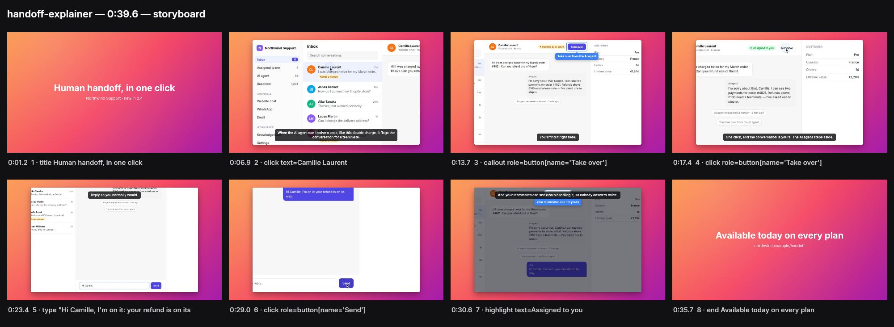
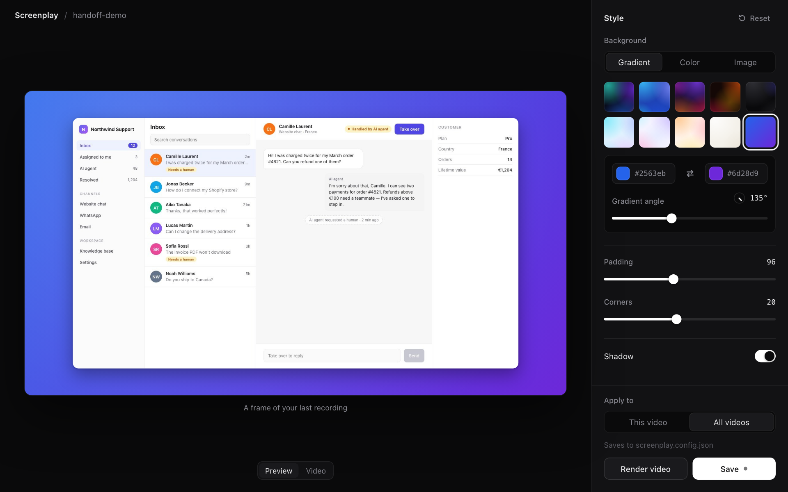

# Screenplay

https://github.com/user-attachments/assets/dd9898da-4900-4a91-8620-57a860c46093

**Screen Studio-quality screen recordings, made by your AI agent.**

Ask Claude Code, Codex, Cursor or any agent: *"Make a video that shows how human handoff works"*. The agent explores your app and writes a short **scenario**; Screenplay plays it in a browser (or a desktop app), films it, and edits the video like Screen Studio would: smooth cursor, automatic zooms that follow the action, click effects, callouts, spotlight, captions, title cards, and an optional voice-over.



Screenplay contains no AI and needs no model key: your agent does the thinking, Screenplay does the filming and editing.

## Install

```bash
npx agent-screenplay init
```

The npm package is `agent-screenplay`; installed globally (`npm i -g agent-screenplay`), its command is `screenplay`.

`init` downloads Chromium (once), adds the Screenplay MCP server to the agents it finds (Claude Code, Codex, Cursor), and installs the guide that teaches them to make good videos. Restart your agent after it.

## Use it

In **Claude Code**, type `/screenplay` and say what you want:

```
/screenplay Make a 30-second walkthrough of https://askli.co
/screenplay Film how to invite a teammate in our app, with a French voice-over
```

In **Codex, Cursor** or any agent with the MCP server, just ask: *"Make a screen recording of …"*. The agent explores the site, asks whether you want a voice-over, writes the scenario, films it, checks the storyboard and gives you the MP4. To change the look afterwards: `npx agent-screenplay style <scenario.json>`.

Without MCP, any agent that can run commands can use the CLI directly:

```bash
npx agent-screenplay guide                    # how to write a good scenario
npx agent-screenplay check demo.json          # plays the steps fast, without filming
npx agent-screenplay record demo.json         # films and edits → demo.mp4 + demo.storyboard.png
npx agent-screenplay render demo.json         # re-edits the last take (style, zoom, text, voice) without filming
```

Requirements: Node 20+. ffmpeg and the drawing library ship with the package.

## A scenario

```json
{
  "url": "https://app.example.com/inbox",
  "style": { "background": "dawn" },
  "steps": [
    { "title": "Human handoff, in one click", "subtitle": "New in 2.4" },
    { "click": "text=Camille Laurent", "say": "When the AI agent gets stuck, the conversation lands in your inbox." },
    { "callout": "role=button[name='Take over']", "text": "Take over from the AI agent" },
    { "click": "role=button[name='Take over']", "say": "One click, and the conversation is yours." },
    { "type": "Hi Camille, I'm on it.", "into": "placeholder=Write a reply…" },
    { "click": "role=button[name='Send']" },
    { "highlight": "text=Assigned to you", "text": "Your teammates see it's yours" },
    { "end": "Available today on every plan" }
  ]
}
```

- **Targets** name elements the way people see them: `text=…`, `role=button[name='…']`, `label=…`, `placeholder=…`, `testid=…`, `css=…` (web only), `at=x,y` (desktop apps without accessible elements only).
- **Actions**: `goto`, `click`, `type`, `press`, `hover`, `scroll`, `select`, `wait`, `pause`.
- **Direction**: `title` and `end` cards, `callout` (a bubble pointing at an element), `highlight` (spotlight), `zoomTo`, and on any step `say` (caption and voice), `zoom`, `hold`.
- **Style**: background preset (soft light gradients: `dawn`, `iris`, `citrus`, `apricot`, `coral`, `blaze`, `cloud`, `glacier`, `tide`, `meadow`), your own gradient, a color or an image; padding, corner radius, shadow, the cursor (`arrow` by default, a rounded arrow in the accent color; `macos`, `dot`) and its click effect (`ripple` by default; `rays`, `confetti`, `sparkle`), maximum zoom, browser frame, accent color. See [Style](#style).
- **Output**: 1920×1080 at 30 fps by default; any size up to 4K, 24 to 60 fps, optional GIF.

The full format is the JSON schema in [`schema/scenario.schema.json`](schema/scenario.schema.json) (`npx agent-screenplay schema`), and the agent guide in [`skills/screenplay/SKILL.md`](skills/screenplay/SKILL.md). Examples are in [`examples/`](examples).

`check` and `record` really perform the steps (a "Send" click sends): point scenarios at a demo account or a staging environment.

## Style

Set the look by eye: `npx agent-screenplay style demo.json` opens an editor in your browser, on a frame of the last recording. Pick a gradient (or make your own), a color or an image (drop it on the page), set the padding, corners and shadow, then save to **this video** or to **all videos**, and render without filming again.



"All videos" writes `screenplay.config.json`, which applies to every scenario in its folder and below; a scenario's own `style` wins, setting by setting. The same settings by hand:

```json
{
  "style": {
    "background": { "gradient": ["#0ea5e9", "#6366f1"], "angle": 135 },
    "padding": 96,
    "radius": 20,
    "shadow": true
  }
}
```

Title and end cards (`title` and `end` steps) are **off by default**: turn them on with `"cards": true`, or with the switch in the editor.

`background` is a preset name (`dawn` by default; earlier presets such as `aurora` or `ocean` still work), a color (`"#0f172a"`), an image path (relative to the file that sets it), or `{ "gradient": [2 to 4 colors], "angle": degrees }`.

## Signing in

- `npx agent-screenplay login https://app.example.com` opens a browser window: sign in, then **close the window**. The session is saved to `.screenplay/auth.json` (while you go, and when the window closes; Enter in the terminal works too). Use it with `"auth": { "storageState": ".screenplay/auth.json" }`. Keep that file out of git.
- **Bot checks** (Cloudflare's "Just a moment…"): Screenplay's browser presents itself as an ordinary Chrome, so the checks that need no person pass by themselves. When a site asks a person to prove they are human, `check` says so: run `login` on that site, pass the check in the window, close it, and set `auth.storageState`. Some sites ask again on every visit; those cannot be filmed automatically.
- Agents without a screen can sign in with steps: `{ "type": "${EMAIL}", "into": "label=Email" }`, `{ "type": "${PASSWORD}", "into": "label=Password", "secret": true }`. `${VAR}` is read from the environment; `secret` masks the text in captions and logs.

## Voice-over

Off by default. Turn it on per scenario:

```json
"voice": { "enabled": true, "language": "fr" }
```

Each step's `say` is spoken, and the video waits for each sentence to finish, so the voice sets the pace. Three ways to get the voice:

- **[Cartesia](https://cartesia.ai)**: set `CARTESIA_API_KEY`.
- **[ElevenLabs](https://elevenlabs.io)**: set `ELEVENLABS_API_KEY`. When both keys are set, Cartesia is used unless `"provider": "elevenlabs"`.
- **Your own audio files**, with no key: give a step `"audio": "voice/02.mp3"` (MP3, WAV, M4A…), for instance lines you generated in ElevenLabs' or Cartesia's web app. The agent can write the narration for you, one line per step, ready to paste there. Adding audio needs no new filming: `render`.

Narration is cached: re-rendering with unchanged text costs nothing. `voice.id` picks another voice, `voice.speed` its pace. Without voice, `say` still shows as a caption.

## Desktop apps

Use `"app": "<name>"` instead of `"url"`. The steps are played through the operating system's accessibility APIs by [agent-desktop](https://github.com/vercel-labs/agent-desktop) (installed with Screenplay), and the window is filmed with ffmpeg without the system cursor; the editing is the same as for websites.

| | Needs |
|---|---|
| macOS | Allow your terminal or agent app in System Settings → Privacy & Security → **Screen Recording** and **Accessibility** |
| Windows | Nothing |
| Linux | An **X11** session with the AT-SPI accessibility bus (standard on GNOME). Wayland is not supported: it blocks screen capture and synthetic input by design |

Desktop recordings need a real screen: they cannot run in a headless container. Websites can.

While Screenplay drives the computer, a pill at the top of the screen says so ("Screenplay is recording", or "rehearsing" during a check), with a **Stop** button that ends the run at once. The pill is left out of the capture, so it is never in the video. macOS and Windows; `SCREENPLAY_INDICATOR=0` turns it off.

### The whole screen

`"screen": true` films the whole main screen instead of one window, for videos that go from one app to another or use the menu bar. `{ "open": "<app>" }` launches an app or brings it to the front, a step's `"app"` acts in another app, and `"surface": "menubar"` (or `menu`, `sheet`, `popover`, `alert`) finds elements outside the app's window. Everything on screen is filmed, desktop icons and notifications included: tidy the screen first; on macOS `"hideOthers": true` hides the other apps.

## How it works

```
scenario.json ──▶ play + film ──────────────────▶ take (frames + timeline of actions)
                  web: Playwright, headless Chromium          │
                  desktop: agent-desktop + ffmpeg             ▼
                                                  edit: time remap (long waits sped up),
                                                  camera (spring zooms), cursor path,
                                                  overlays, captions, voice track
                                                              │
                                                              ▼
                                                  draw each frame (Skia) → ffmpeg → MP4
```

Screenplay knows exactly where and when each click happens, and the box of every element it acts on, so zooms are framed on the element instead of guessed from mouse movement. The cursor is drawn during editing, along a smooth human-like path.

## Development

```bash
npm install
npm run build
npm test                 # unit tests
npm run test:e2e         # records a real scenario in headless Chromium and talks to the MCP server
```

### Releasing

```bash
npm version patch --no-git-tag-version   # or minor / major; also updates src/version.ts
```

Merge that change, then tag the commit on main:

```bash
git tag v0.1.4 origin/main && git push origin v0.1.4
```

The tag starts `.github/workflows/release.yml`. It checks that the tag matches the version and is on main, runs the tests, publishes to npm (with provenance) and creates the GitHub release with notes from the merged pull requests. A version like `0.2.0-beta.1` goes to npm's `next` tag. Creating a release in GitHub's UI with a new tag works too.

`examples/demo-app` is a small web app for trying scenarios; `examples/desktop-app/notes.py` is a GTK app for desktop recording on Linux.

## License

MIT. Bundled: [Inter](https://rsms.me/inter/) (SIL Open Font License), ffmpeg through `ffmpeg-static` (GPL), agent-desktop (Apache-2.0).
